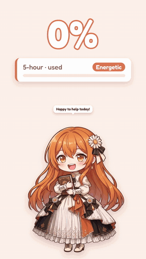
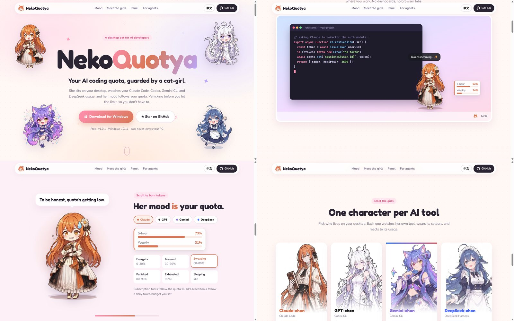

# NekoQuotya

**She knows before your quota runs out.** A desktop pet that watches your AI coding tools' token usage and subscription quotas, and her mood follows them. Design: [docs/architecture.md](docs/architecture.md).

<p align="center">
  <a href="https://zhangpl666ya.github.io/NekoQuotya/"></a>
</p>

**🌸 Website: [zhangpl666ya.github.io/NekoQuotya](https://zhangpl666ya.github.io/NekoQuotya/)** · 17-second promo video (中文 / English) on the site and in [`promo/final/`](promo/final/)

[](https://zhangpl666ya.github.io/NekoQuotya/)

## Install (Windows)

1. Download the latest `NekoQuotya-Setup-<version>.exe` from [Releases](../../releases/latest).
2. Run it. The installer is not code-signed yet, so Windows SmartScreen may warn: choose **More info → Run anyway**.
3. The pet appears on the desktop and an icon appears in the tray. Click the tray icon for the panel.

Characters (one pet on the desktop at a time, chosen in Settings):

| Pack | Tool it watches | Quota | Mood follows |
|---|---|---|---|
| Claude | Claude Code (`~/.claude`) | Claude subscription | quota % |
| GPT | Codex CLI (`~/.codex`) | ChatGPT subscription | quota % |
| Gemini | Gemini CLI (`~/.gemini`) | — | daily token budget |
| DeepSeek | DeepSeek Harness (`~/.dsh`) | — (API billing) | daily token budget |

Using the pet: click to poke (her quota bars show for a few seconds), drag to move (the position is remembered), double-click to open the panel, right-click for a menu. In the panel, click a card for its activity heatmap, 60-day trend and sessions, and drag cards to reorder them. **Check for updates** in the panel footer asks GitHub for a newer release. Settings has the language (system / English / 简体中文), the pet picker, daily budget, mood basis, sleep time and idle chatter. Launch at startup is in the panel footer.

Your data stays on your computer: usage is read locally by tokscale and stored in `%APPDATA%\NekoQuotya\packs\<pack>\data`. Uninstalling leaves that folder in place.

Using an AI agent to set it up? Point it at [For AI agents](#for-ai-agents-configuring-nekoquotya-for-a-user).

## For AI agents: configuring NekoQuotya for a user

This section is written for coding agents (Claude Code, Codex, etc.) helping a user set up or customize NekoQuotya. All paths are for the **installed app** on Windows.

### Where things live

| What | Path | Notes |
|---|---|---|
| App | `%LOCALAPPDATA%\Programs\NekoQuotya\NekoQuotya.exe` | default per-user install |
| Packs (one per AI tool) | `%APPDATA%\NekoQuotya\packs\<id>\` | `pack.json`, `appearance/`, `data/` |
| User settings per pack | `%APPDATA%\NekoQuotya\packs\<id>\data\settings.json` | survives upgrades |
| Usage ledger | `%APPDATA%\NekoQuotya\packs\<id>\data\history.json` | **never delete**: it keeps sessions whose logs the tool has cleaned up |
| Status and errors | `%APPDATA%\NekoQuotya\packs\<id>\data\status.json` | `lastError.code` explains failures |
| Card order | `%APPDATA%\NekoQuotya\layout.json` | `{ "packOrder": ["claude", "gpt", ...] }` |

Quit the app (tray icon → right-click → Quit) before editing any file, then start it again. Changes are read at startup.

### 1. Check that the user's tool is detected

NekoQuotya reads all usage through [tokscale](https://github.com/junhoyeo/tokscale) 4.20.1, bundled at `<install dir>\resources\bin\tokscale.exe`:

```powershell
& "$env:LOCALAPPDATA\Programs\NekoQuotya\resources\bin\tokscale.exe" clients        # scan locations and message counts per client (✓ = found)
& "$env:LOCALAPPDATA\Programs\NekoQuotya\resources\bin\tokscale.exe" usage --json   # subscription quotas, by provider name
```

Built-in packs and what they need:

| Pack id | tokscale client | Default log folder | Quota provider |
|---|---|---|---|
| `claude` | `claude` | `~/.claude` (or `CLAUDE_CONFIG_DIR`) | `Claude` |
| `gpt` | `codex` | `~/.codex` (or `CODEX_HOME`) | `Codex` |
| `gemini` | `gemini` | `~/.gemini` | none |
| `deepseek` | `dsh` (DeepSeek Harness) | `~/.dsh` | none |

If a tool shows ✗ in `tokscale clients`, the user hasn't used it on this machine yet, or its logs are somewhere else. If the quota is missing, the user is probably not signed in to that tool's CLI.

### 2. Change behavior (budget, mood, sleep, chatter)

Prefer the in-app Settings window. To script it, write `data\settings.json` for the pack. Only these keys are read:

```json
{
  "behavior": {
    "dailyBudget": 2000000,
    "moodBasis": "quota",
    "idleSleepMinutes": 30,
    "chatterMinutes": [15, 30]
  }
}
```

- `moodBasis`: `"quota"` follows the subscription quota %, `"budget"` follows `dailyBudget`. A pack without a quota provider always uses the budget.
- `dailyBudget`: input + output tokens per day that count as 100%.
- `chatterMinutes`: `null` turns idle chatter off.

Invalid values are ignored, and the pack's default is used instead.

### 3. Add a pack for another AI tool

Do **not** edit a built-in pack's `pack.json`: it is replaced when the app updates. Create a new folder with a new id instead, e.g. `%APPDATA%\NekoQuotya\packs\kimi\pack.json`:

```json
{
  "id": "kimi",
  "name": "Kimi",
  "version": 1,
  "packFormat": 1,
  "source": {
    "tokscaleClients": ["kimi"],
    "quotaProvider": null,
    "watch": [{ "path": "~/.kimi/sessions" }]
  },
  "behavior": { "dailyBudget": 2000000, "moodBasis": "budget" },
  "theme": { "color": "#3D5AFE" },
  "appearance": { "renderer": "placeholder" }
}
```

Rules:
- `id` must match the folder name: lowercase letters, digits and `-`.
- `tokscaleClients` are ids from `tokscale --help` (`--client` values), e.g. `opencode`, `cursor`, `qwen`, `kimi`, `cline`, `roocode`, `cherrystudio`. Each client may belong to only one pack, so don't reuse `claude`, `codex`, `gemini` or `dsh`.
- `quotaProvider` is a provider name from `tokscale usage --json` (e.g. `"Claude"`, `"Codex"`, `"Copilot"`), or `null`.
- `watch` lists log folders to watch for live updates. It supports `~` and `${ENV_VAR|default}`. Without it, usage still refreshes every 5 minutes.
- `theme.gradient` (2–4 `#rrggbb` colours) is optional.

Art is optional. With `"renderer": "placeholder"` the pet is a simple drawn face. For images, put transparent PNGs of one size in `appearance/`:
- `energetic.png`, `focused.png`, `sweating.png`, `panicked.png`, `exhausted.png` and `sleeping.png`. Only `energetic.png` is required; missing ones fall back.
- An optional `card.png` for the panel card.

Then add `appearance/appearance.json`:

```json
{
  "size": [180, 180],
  "images": {
    "mood.ENERGETIC": "energetic.png", "mood.FOCUSED": "focused.png", "mood.SWEATING": "sweating.png",
    "mood.PANICKED": "panicked.png", "mood.EXHAUSTED": "exhausted.png", "activity.sleeping": "sleeping.png"
  }
}
```

Finally, set `"appearance": { "renderer": "image", "entry": "appearance/appearance.json", "card": "appearance/card.png" }`.

A pack that fails validation is skipped, and the reason is shown at the bottom of the tray panel.

### Environment variables

- `NEKO_LANG=en` or `zh-CN`: force the UI language (the default follows the system).
- `NEKO_TOKSCALE_PATH`: use a different tokscale executable.
- `HTTPS_PROXY` / system proxy: used for quota queries.

## Development

```bash
npm install
npm run build && npm start   # run the app from source
npm run dev                  # the same, rebuilding on file changes
npm run dist                 # build the Windows installer into dist/
```

Headless tools for the data layer:

```bash
npm run pet              # keep running and print the pet's live reactions; type p + Enter to poke her
npm run collect          # keep running: auto refresh; type r + Enter to refresh now, s + Enter to re-verify history
npm run collect:once     # one pass of today, history catch-up and quota, then exit
npm run collect:resync   # re-verify all history, then exit
npm test                 # unit tests
npm run typecheck        # type check
```

Add `-- --lang zh-CN` for Chinese output (English by default).

## Packs

One folder per AI tool (`claude`, `gpt`, `gemini`, `deepseek`), for example `packs/claude/`:

```
packs/claude/
  pack.json        data sources, behavior settings, appearance
  appearance/      static images per mood, sleeping, and the panel card art
  lines/           speech bubbles in the character's voice: en.json, zh-CN.json (key → variants)
  data/            written by the app
    history.json   the ledger: date → session → model. Survives log cleanup; cannot be rebuilt — do not delete
    backups/       daily copies of history.json (newest 7)
    today.json     today's usage, by session
    quota.json     subscription quota: 5-hour / weekly windows and reset times
    status.json    tokscale version, watch state, ledger stats, hints and errors
```

## How the data works

- Usage and quotas come from [tokscale](https://github.com/junhoyeo/tokscale) `4.20.1` (pinned); this project never parses logs itself.
- **Ledger rule:** sessions are never deleted. A rescan updates sessions it finds and retains (`retained`) those whose logs the AI tool has cleaned up.
- **Automatic refresh:** today's usage updates within seconds of a log change, with a fallback scan every 5 minutes; quota refreshes every 2 minutes while active, otherwise every 10.
- **Manual refresh:** available at any time (`r` in the CLI, a button in the app); refreshes today, catches up history and queries quota immediately.
- **Finished days are not rescanned on a timer:** missing days are caught up at midnight, on start and on resume; everything is re-verified when the tokscale version changes, with sessions renamed by the upgrade replaced rather than counted twice.
- `output` includes reasoning tokens (tokscale lists them separately; they are added back).
- Active tokens = input + output, excluding cache.
- Costs are estimates from public prices; for subscribers they are only a reference.
- A failed quota query keeps the previous values marked `stale`; nothing drops to zero.
- Data files contain no display text: windows are identified by kind and errors by code; all text comes from `src/shared/i18n/` (English default, Chinese included).
